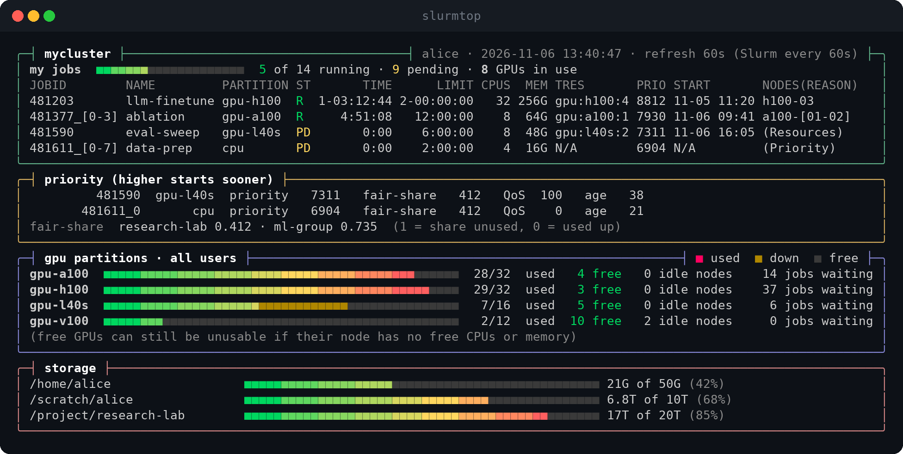

# slurmtop

A single-file Bash dashboard for your Slurm jobs, their priority, how busy the GPU
partitions are, and your storage, refreshed live in the terminal.



## Features

- Your jobs, including job arrays, in a compact table: state, run time, time limit, CPUs,
  memory, GPUs, priority, expected start, and the nodes or the reason a job is waiting
- The priority breakdown of your pending jobs and the fair-share of your accounts
- GPU partitions at a glance: GPUs used, down, and free, idle nodes, and how many jobs are
  waiting (other users' jobs appear only as counts)
- Storage use for the paths you choose
- Runs on a cluster login node, or on your own computer over ssh, reusing one connection
- Light on the scheduler: Slurm is asked at most every 15 seconds and storage every
  10 minutes, whatever the refresh interval
- Redraws in place without flicker; `r` refreshes now, `q` quits
- Rounded panels and gradient meters in 256-color terminals, with fallbacks for basic and
  non-UTF-8 terminals

## Requirements

- On the machine that runs it: Bash 4+, `awk`, `tput`, and `ssh` when Slurm runs elsewhere
- On the cluster: the Slurm commands `squeue`, `sprio`, `sshare`, and `scontrol`, plus
  `awk`, `df`, and `timeout`
- For use over ssh: a login that needs no password prompt (an ssh key or agent)

## Install

```sh
curl -fsSLo slurmtop https://raw.githubusercontent.com/the-farshad/slurmtop/main/slurmtop
chmod +x slurmtop
./slurmtop
```

Or clone the repo and place the script on your `PATH`:

```sh
git clone https://github.com/the-farshad/slurmtop.git
cp slurmtop/slurmtop ~/.local/bin/
```

## Usage

```sh
slurmtop              # live view, refreshed every minute
slurmtop 30s          # refresh every 30 seconds
slurmtop 5m           # refresh every 5 minutes
slurmtop --once       # print one screen and exit
slurmtop -h           # show help
```

The interval can be 1 second to 1 hour, written as `30`, `30s`, `5m`, or `1h`. Shorter
intervals redraw more often, but Slurm itself is never asked more than once every
15 seconds. Press `r` to refresh now and `q` to quit.

### From your own computer

When Slurm is not installed locally, point `SLURMTOP_HOST` at a login node, either a host
name or a `Host` alias from `~/.ssh/config`:

```sh
SLURMTOP_HOST=login.mycluster.example slurmtop
```

The ssh connection is opened once and kept for 15 minutes, so later refreshes are quick.

## Configuration

All settings are environment variables:

| Variable              | Default                                     | Description                                                     |
|-----------------------|---------------------------------------------|-----------------------------------------------------------------|
| `SLURMTOP_HOST`       | none (Slurm on this machine)                | ssh host to run the Slurm commands on                           |
| `SLURMTOP_PARTITIONS` | GPU partitions your accounts and groups may use | Space-separated GPU partitions to show                       |
| `SLURMTOP_ACCOUNT`    | all of your accounts                        | Account to show the fair-share of                               |
| `SLURMTOP_PATHS`      | `~`                                         | Space-separated paths on the cluster to show storage for; `~` and `$USER` are expanded on the cluster |

Example, for a shell startup file:

```sh
export SLURMTOP_HOST=mycluster
export SLURMTOP_PARTITIONS="gpu-a100 gpu-h100"
export SLURMTOP_PATHS='~ /scratch/$USER'
```

## Notes

- GPU counts come from each node's configured and allocated GPUs (`gres/gpu`). A free GPU
  can still be unusable when its node has no free CPUs or memory.
- "jobs waiting" counts every user's pending jobs that may run in the partition; a job
  submitted to several partitions counts in each of them.
- Storage shows what `df` reports for each path: the size of the file system, or your
  quota on file systems that report quotas as their size.

## License

MIT — see [LICENSE](LICENSE).
